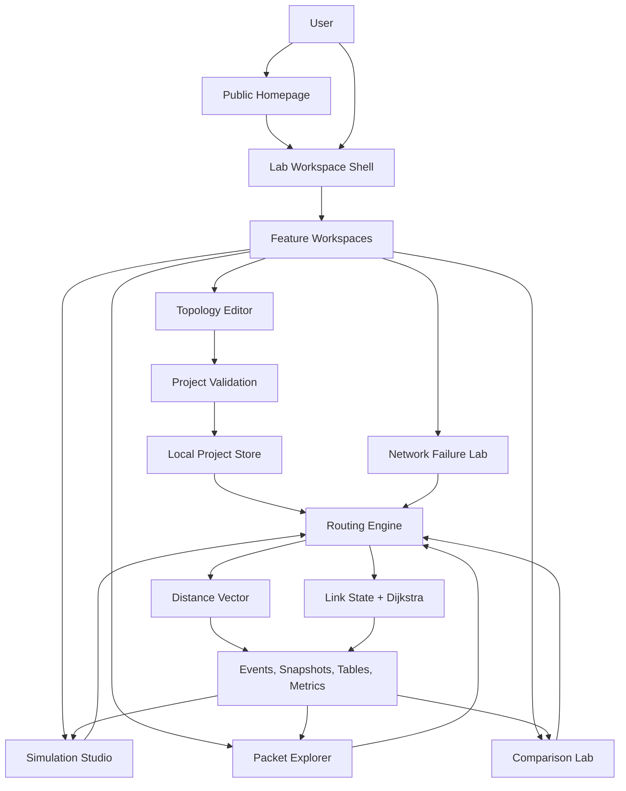

# RouteLab — Final Project Report

**Project title:** RouteLab — An Interactive Web-Based Simulator for Distance Vector and Link State Routing Algorithms  
**Course:** Computer Networks  
**Project type:** Mini Project / Case Study  
**Student:** [Enter student name]  
**Roll number:** [Enter roll number]  
**Institution / Department:** [Enter institution and department]  
**Faculty / Guide:** [Enter faculty name]  
**Academic session:** [Enter academic session]  
**Submission date:** [Enter date]

> **Preparation note:** This report is grounded in the RouteLab project charter, algorithm specification, implementation notes, source architecture and test files. Replace the bracketed fields, add screenshots from the actual deployed/local build, and enter the test/build/audit results produced on the submission machine. Do not present a test or deployment as successful until it has been run and observed.

---

## Abstract

Computer networks rely on routing algorithms to determine how data should travel from a source network node to a destination. Although routing is often taught through equations and final routing tables, the intermediate information exchanges and path-selection decisions can be difficult to visualize. RouteLab is an interactive, browser-based educational simulator designed to make these decisions observable.

The application allows a learner to construct a small weighted network topology, configure router-to-router link costs, and run two routing approaches: Distance Vector and Link State. The Distance Vector model uses synchronous neighbour-table exchanges based on the Bellman-Ford recurrence. The Link State model simulates Link State Advertisement (LSA) origination and deterministic flooding, followed by a Dijkstra shortest-path calculation at each router. Learners can inspect the event sequence, routing tables, next hops and path costs through a step-driven Simulation Studio.

RouteLab also includes a Packet Explorer that derives a conceptual packet journey from the calculated forwarding tables, a Network Failure Lab for controlled link/cost experiments, and a Comparison Lab for examining common route outcomes and algorithm-specific model-work metrics. The application is implemented with React, JavaScript and Vite, with React Flow used for topology editing. User projects are stored locally in the browser and can be imported or exported as JSON.

RouteLab is an educational simulator rather than a production implementation of RIP or OSPF. Its purpose is to support understanding of routing concepts through repeatable experiments and inspectable results.

**Keywords:** Computer Networks, Routing, Distance Vector, Link State, Bellman-Ford, Dijkstra, LSA Flooding, Network Simulation, React.

---

## 1. Introduction

### 1.1 Background

A router receives packets and uses its forwarding information to select the next hop toward a destination. In a network with several possible paths, the route selected depends on the topology, link costs and the routing information available to each router.

Two foundational routing approaches are Distance Vector and Link State. Distance Vector routers exchange reachability and path-cost information with their immediate neighbours. Link State routers distribute information about their directly connected links, build a topology database and compute shortest paths.

Both approaches can be described mathematically, but the sequence of updates is not always apparent from a static diagram. RouteLab provides a visual environment in which the network and the algorithm's intermediate decisions can be inspected.

### 1.2 Problem statement

Students commonly learn routing algorithms through equations, manually completed tables and static network diagrams. These methods may show the final route but hide how routers learn about destinations, how candidate costs are compared, how link information propagates, and how a route changes when a link becomes unavailable.

The problem addressed by RouteLab is the lack of a small, interactive and repeatable learning environment that connects a network topology to the intermediate algorithm events, routing tables and forwarding decisions that produce a route.

### 1.3 Proposed solution

RouteLab provides one shared network model and multiple learning workspaces. A learner can create or load a topology, select a routing algorithm, follow its events, inspect route tables, trace a conceptual packet and perform controlled link-failure or link-cost experiments.

### 1.4 Objectives

1. Provide an interactive editor for small weighted network topologies.
2. Implement a deterministic educational Distance Vector model.
3. Implement a deterministic educational Link State model with LSA flooding and Dijkstra.
4. Display algorithm events and routing-table changes step by step.
5. Derive packet paths from actual next-hop forwarding-table entries.
6. Allow safe experiments with link status and link cost.
7. Compare route outcomes without treating unlike algorithm counters as equivalent speed measurements.
8. Keep algorithm and graph logic independent of the React presentation layer.

---

## 2. Scope and Assumptions

### 2.1 Included scope

- Public product homepage and dedicated lab workspace.
- Interactive router/link topology editor.
- Predefined network topology examples.
- Local project save, open, import and export.
- Distance Vector routing calculation and event generation.
- Link State LSA origination, flooding and Dijkstra calculations.
- Simulation playback, event inspection and routing-table exploration.
- Conceptual packet forwarding based on validated next-hop information.
- Link enable/disable and link-cost experiments.
- Side-by-side routing comparison and algorithm-specific metrics.
- Responsive light and dark user interface.

### 2.2 Model assumptions

| Parameter | Model used in RouteLab |
|---|---|
| Graph | Undirected weighted graph |
| Router count | 1–20 routers in the editor |
| Link cost | Positive integer from 1 to 999 |
| Link state | Up or down |
| Down link | Excluded from algorithm input |
| Disconnected components | Valid topology |
| Determinism | Stable ordering and tie-breaking |
| Persistence | Browser LocalStorage and JSON export/import |
| Network traffic | Simulated route marker; no real packet capture |

### 2.3 Out of scope

RouteLab does not configure physical routers, capture live operating-system traffic, implement every requirement of complete RIP or OSPF deployments, or simulate transport-layer congestion, packet loss and timer-based convergence. Its models are simplified for classroom explanation and repeatability.

---

## 3. Routing Concepts

### 3.1 Network graph

A network is represented as a graph (G=(V,E)), where:

- (V) is the set of routers.
- (E) is the set of active physical links.
- Each link has a positive cost (c(u,v)).

For the first release, links are undirected, so a physical connection between routers (u) and (v) is usable in both directions when it is up.

The cost of a path is the sum of the costs of its links:

[
C(P)=sum_{(u,v)in P}c(u,v)
]

The shortest path is the valid path with minimum total cost.

### 3.2 Distance Vector routing

Distance Vector is based on the Bellman-Ford recurrence. Each router keeps an estimate of the cost to each destination and obtains information from directly connected neighbours.

For router (x), destination (y), and neighbour (v):

[
D_x(y)=min_{vin N(x)}left[c(x,v)+D_v(y)
ight]
]

RouteLab uses a synchronous educational model:

1. Freeze all routers' current tables at the start of a round.
2. Model vector exchange over every active directed neighbour relationship.
3. Calculate candidate routes using only the previous-round tables.
4. Select the lowest finite candidate cost.
5. Break equal-cost next-hop ties deterministically by router ID.
6. Commit all next tables simultaneously.
7. Emit events for changed entries.
8. Stop when a full round produces no changes, subject to the specified safety bound.

This is not a timer-driven RIP deployment. The model does not implement split horizon, poisoned reverse, triggered updates, hold-down timers or packet loss.

### 3.3 Link State routing

In a Link State approach, routers distribute information about their directly connected links. The received information is used to build a link-state database (LSDB). A shortest-path algorithm is then run using the database.

RouteLab models three stages:

1. **LSA origination:** each router creates an advertisement containing its active neighbours and link costs.
2. **LSA flooding:** advertisements are propagated over active links, with deterministic queue ordering and duplicate suppression.
3. **Shortest-path calculation:** each router runs Dijkstra using its LSDB to calculate routes to reachable destinations.

Dijkstra initializes the source distance to zero and all other distances as infinity. It repeatedly settles the unsettled router with the smallest tentative distance and relaxes its known neighbours. Deterministic tie-breaking makes repeated executions reproducible.

This is a simplified educational Link State model, not a complete OSPF implementation.

---

## 4. System Requirements

### 4.1 Functional requirements

| ID | Requirement |
|---|---|
| FR-01 | The user can create, select, move and delete routers within the supported limit. |
| FR-02 | The user can create and delete undirected links. |
| FR-03 | The user can edit a link cost and its up/down status. |
| FR-04 | The user can load predefined topologies. |
| FR-05 | The user can save, reopen, import and export project JSON. |
| FR-06 | The user can run Distance Vector on a validated topology. |
| FR-07 | The user can run Link State on a validated topology. |
| FR-08 | The user can inspect ordered algorithm events and snapshots. |
| FR-09 | The user can play, pause, step and reset simulation playback. |
| FR-10 | The user can inspect router routing tables. |
| FR-11 | The user can select source/destination routers in Packet Explorer. |
| FR-12 | Packet hops are derived from forwarding-table next-hop entries. |
| FR-13 | The user can perform a link/cost failure experiment without silently overwriting the baseline project. |
| FR-14 | The user can compare both algorithms on the same saved network revision. |
| FR-15 | The UI communicates unreachable destinations and invalid input explicitly. |

### 4.2 Non-functional requirements

- Deterministic algorithm outputs for identical normalized inputs.
- Strict validation before algorithms run.
- Clear separation between domain logic and UI components.
- Responsive layout and keyboard-accessible controls.
- Reduced-motion support.
- Readable colour contrast and theme consistency.
- Reproducible dependency installation through the committed lockfile.
- Automated tests and a production build in CI.

---

## 5. System Architecture

### 5.1 Architectural principle

The routing engine is a pure, testable domain layer. React renders its outputs but does not own routing logic.

### 5.2 Main layers

1. **Presentation layer:** pages, navigation, topology canvas, controls, tables and visualizations.
2. **Feature orchestration:** topology editing, simulation, packet exploration, failure experiments and comparison.
3. **Domain and validation:** router/link data, topology validation, route entries and simulation contracts.
4. **Algorithm engine:** graph normalization, Distance Vector, LSA flooding and Dijkstra.
5. **Persistence adapter:** browser LocalStorage and JSON import/export.

### 5.3 Architecture diagram



### 5.4 Technology stack

| Layer | Technology | Role |
|---|---|---|
| UI | React | Component-driven interface |
| Language | JavaScript | Application and algorithm logic |
| Build tool | Vite | Development server and production bundle |
| Styling | Tailwind CSS v4 and project CSS tokens | Responsive styling and design system |
| Network canvas | @xyflow/react | Router nodes and link editing |
| Icons | Lucide React | Interface iconography |
| Routing | React Router | Public and lab routes |
| Persistence | Browser LocalStorage | Local project library and preferences |
| Testing | Node.js built-in test runner | Domain, feature and regression tests |

---

## 6. Implementation Modules

### 6.1 Application and navigation

The root route `/` is the public homepage. The interactive tools live below `/lab/*`. The lab shell includes top navigation and a collapsible sidebar. Existing root-level workspace URLs redirect to their new lab equivalents for bookmark compatibility.

### 6.2 Network Studio

The topology editor uses routers as nodes and links as edges. It supports editing router display labels, link cost/status, selecting entities, loading presets and saving local projects. Stable router IDs are retained independently of display labels.

### 6.3 Routing engine

The engine normalizes the project model and runs the selected algorithm independently of UI state. It returns structured route tables, event records, metrics and replay snapshots.

### 6.4 Simulation Studio

The Simulation Studio consumes actual algorithm events and snapshots. It supports playback and step navigation, visual activity highlighting, event inspection and routing-table exploration. Animation timing is a presentation concern; it does not change algorithm calculations.

### 6.5 Packet Explorer

The packet journey is conceptual. At each hop, the selected router's own forwarding-table entry determines the next hop. The path must use active links and remain consistent with the route cost. It does not create or transmit real network packets.

### 6.6 Network Failure Lab

A failure experiment creates a modified topology variant, such as a disabled link or a changed link cost. The selected algorithm is rerun from initialization. The baseline project is preserved unless the user explicitly saves the experiment as a separate project.

### 6.7 Comparison Lab

The comparison uses the same saved topology and revision for both algorithms. Directly comparable outcomes include reachability and minimum route cost. Distance Vector rounds/vector messages and Link State LSA/Dijkstra counters are presented separately because they count different kinds of work.

---

## 7. Algorithm Pseudocode

### 7.1 Distance Vector

```text
INITIALIZE each router x:
    cost[x][x] = 0
    nextHop[x][x] = null
    for each direct active neighbour v:
        cost[x][v] = linkCost(x, v)
        nextHop[x][v] = v
    all other destinations = unreachable

REPEAT synchronously:
    previous = deep copy of every router table
    changed = false

    for each router x:
        nextTable[x] = previous[x]

        for each destination y:
            if x == y:
                preserve self route
                continue

            candidates = []
            for each active neighbour v of x:
                if previous[v][y] is reachable:
                    candidateCost = linkCost(x, v) + previous[v][y].cost
                    candidateNextHop = v
                    add candidate to candidates

            choose minimum cost candidate
            break equal-cost ties by deterministic next-hop ID
            write the selected route to nextTable[x]
            mark changed if the entry differs from previous[x][y]

    commit all nextTable values simultaneously
    emit ordered round and route-change events
UNTIL changed is false or the documented safety bound is reached
```

### 7.2 Link State

```text
FOR each router:
    originate one LSA containing active neighbours and link costs

FLOOD LSAs:
    enqueue transmissions in deterministic order
    on first reception:
        accept LSA into local database
        forward to active neighbours except incoming neighbour
    on duplicate reception:
        suppress duplicate and record the event

FOR each source router:
    initialize Dijkstra:
        distance[source] = 0
        all other distances = infinity
        all routers are unsettled

    WHILE a reachable unsettled router remains:
        select the unsettled router with minimum tentative distance
        break ties deterministically by router ID
        settle it
        relax its known neighbours in deterministic order
        update predecessor/next-hop data when a better route is found

    produce one route entry per destination
    mark unreachable destinations explicitly
```

---

## 8. Data Model and Persistence

### 8.1 Topology model

A project contains router records and link records. Router identity is stable; display labels and canvas positions are presentation data. Links contain source and target router IDs, an integer cost and an up/down status. The first version treats links as undirected.

Illustrative example:

```json
{
  "routers": [
    { "id": "R1", "name": "Router 1" },
    { "id": "R2", "name": "Router 2" },
    { "id": "R3", "name": "Router 3" }
  ],
  "links": [
    { "id": "L1", "source": "R1", "target": "R2", "cost": 4, "status": "up" },
    { "id": "L2", "source": "R2", "target": "R3", "cost": 3, "status": "up" },
    { "id": "L3", "source": "R1", "target": "R3", "cost": 10, "status": "up" }
  ]
}
```

The actual persisted project includes version and metadata fields defined in the repository's JSON Schema. The shortened example above illustrates graph content only; it is not a replacement for the full schema.

### 8.2 Route entry

Each routing-table entry identifies a destination, next hop, cost, status and selected path. Self routes have cost zero and no next hop. Unreachable routes use a null cost and next hop rather than serializing JavaScript Infinity.

### 8.3 Persistence

Projects are stored in the current browser's LocalStorage. JSON export allows a user to back up or transfer a topology. No account, backend or cloud synchronization is included in the current product scope.

---

## 9. Testing Strategy

### 9.1 Automated tests

The repository uses Node.js's built-in test runner. The `tests/` directory includes suites for:

- `topology-model.test.js`
- `routing-engine.test.js`
- `simulation-view-model.test.js`
- `packet-routing.test.js`
- `failure-experiment.test.js`
- `algorithm-comparison.test.js`
- UI and accessibility regression tests

The root command `npm test` runs the discovered test files. The current test count and result must be copied from the actual submission-machine run; this report does not invent a count.

### 9.2 Test cases

| ID | Scenario | Expected behaviour |
|---|---|---|
| TC-01 | One router | Self route has cost 0; no other destination exists |
| TC-02 | Direct and cheaper multi-hop alternatives | Minimum cost path is selected |
| TC-03 | Equal-cost alternatives | Deterministic tie-break is used |
| TC-04 | Disabled link | Down link is excluded from routing input |
| TC-05 | Disconnected component | Cross-component destinations are unreachable |
| TC-06 | Invalid link cost | Validation rejects zero, negative, non-integer or out-of-range cost |
| TC-07 | Missing endpoint | Project validation rejects the link |
| TC-08 | Duplicate undirected link | Project validation rejects duplicate connection |
| TC-09 | Packet forwarding | Every hop follows the current router's next-hop entry and an active link |
| TC-10 | Failure experiment | Modified topology is rerun; baseline remains unchanged |
| TC-11 | Algorithm comparison | Both algorithms use the same saved topology revision |
| TC-12 | Sidebar navigation | Collapse/expand, persistence and keyboard/mobile behaviour are preserved |

### 9.3 Manual test evidence to attach

Add screenshots captured from the actual application:
1. Public homepage.
2. Network Studio with a custom topology.
3. Distance Vector Simulation Studio at a meaningful event.
4. Link State Simulation Studio showing LSA or Dijkstra activity.
5. Packet Explorer on a reachable source/destination pair.
6. Failure Lab before/after topology.
7. Comparison Lab with route costs and separate metric profiles.
8. Collapsed desktop sidebar and expanded mobile drawer.

---

## 10. Complexity and Performance Discussion

Let (V) be the number of routers and (E) the number of undirected links.

- **Distance Vector:** the cost depends on the number of synchronous rounds and the work of examining destinations and neighbours. The project specification describes the straightforward implementation at approximately (O(R 	imes V 	imes E)), where (R) is the number of rounds.
- **Dijkstra:** with a simple linear search for the next minimum unsettled vertex, one run is approximately (O(V^2 + E)). RouteLab runs Dijkstra from each router for the all-router routing-table model.
- **LSA flooding:** work depends on topology connectivity, message queue behaviour and duplicate suppression. The simulator counts the actual model events rather than assuming one transmission per physical link.

The project targets small classroom topologies, so clarity and inspectability are prioritized over advanced data structures and large-network optimization.

---

## 11. Limitations

1. Links are undirected in the first version.
2. The editor is intentionally limited to small networks of up to 20 routers.
3. Distance Vector uses synchronous neighbour-table exchange rather than real distributed timers and transport.
4. Link State flooding is a simplified reliable educational model.
5. The simulator does not implement all RIP or OSPF packet formats, timers, authentication, area hierarchy or recovery rules.
6. Packet Explorer animates a conceptual path and does not send operating-system packets.
7. Project persistence is local to the browser; there is no account or cloud-sync service.
8. Event counts are model-work metrics and are not wall-clock convergence measurements.

---

## 12. Future Enhancements

- Optional directed links and asymmetric costs.
- Additional teaching models such as path-vector routing.
- More network topologies and guided exercises.
- IndexedDB for larger local project libraries.
- Optional cloud synchronization if a backend is later justified.
- More advanced protocol behaviour such as split horizon or triggered updates, clearly labelled as separate models.
- Browser-level end-to-end tests for critical workflows.
- Exportable experiment summaries for classroom submissions.

---

## 13. Conclusion

RouteLab turns routing algorithms from static equations and final tables into inspectable processes. Learners can construct a topology, run deterministic Distance Vector and Link State models, inspect event streams and routing tables, trace a conceptual packet, test controlled link changes and compare the resulting route outcomes.

The project's central architectural decision is the separation of the routing engine from the React presentation layer. This makes the algorithm logic independently testable and allows multiple workspaces to consume the same validated result model. The project also makes its educational simplifications explicit so that the interface does not imply full production RIP or OSPF behaviour.

RouteLab therefore provides a focused environment for understanding the relationship between network topology, routing information, shortest-path calculation and packet forwarding.

---

## References

1. Hedrick, C. (1988). *Routing Information Protocol*. RFC 1058. Internet Engineering Task Force. https://www.rfc-editor.org/rfc/rfc1058
2. Malkin, G. (1998). *RIP Version 2*. RFC 2453. Internet Engineering Task Force. https://www.rfc-editor.org/rfc/rfc2453
3. Moy, J. (1998). *OSPF Version 2*. RFC 2328. Internet Engineering Task Force. https://www.rfc-editor.org/rfc/rfc2328
4. Dijkstra, E. W. (1959). A note on two problems in connexion with graphs. *Numerische Mathematik, 1*, 269–271. https://doi.org/10.1007/BF01386390
5. RouteLab project documentation. Project charter, algorithm specification, architecture, contracts and phase implementation notes. https://github.com/Zephyrex21/routelab-network-routing-simulator
6. React documentation. https://react.dev/
7. Vite documentation. https://vite.dev/
8. React Flow documentation. https://reactflow.dev/

---

## Appendix A — Submission Evidence

| Evidence | File / screenshot to add |
|---|---|
| Public homepage | [Insert screenshot] |
| Network Studio | [Insert screenshot] |
| Distance Vector run | [Insert screenshot] |
| Link State run | [Insert screenshot] |
| Packet journey | [Insert screenshot] |
| Network failure experiment | [Insert screenshot] |
| Comparison Lab | [Insert screenshot] |
| Automated test result | [Paste actual `npm test` summary] |
| Production build | [Paste actual `npm run build` result] |
| Dependency audit | [Paste actual `npm audit` summary] |
| Deployment | [Insert public URL and deployment evidence] |

## Appendix B — Reproducible Commands

```bash
npm ci
npm test
npm run build
npm audit --audit-level=high
npm run dev
```
