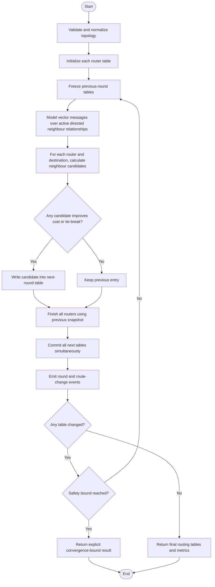
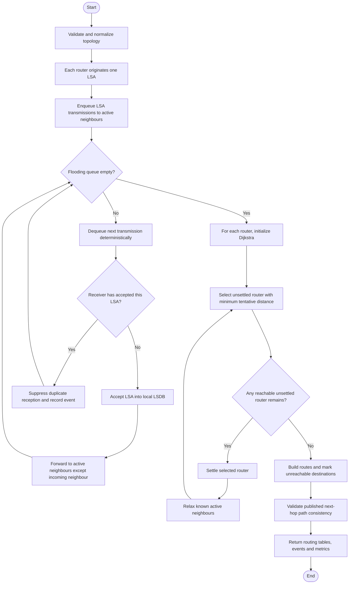
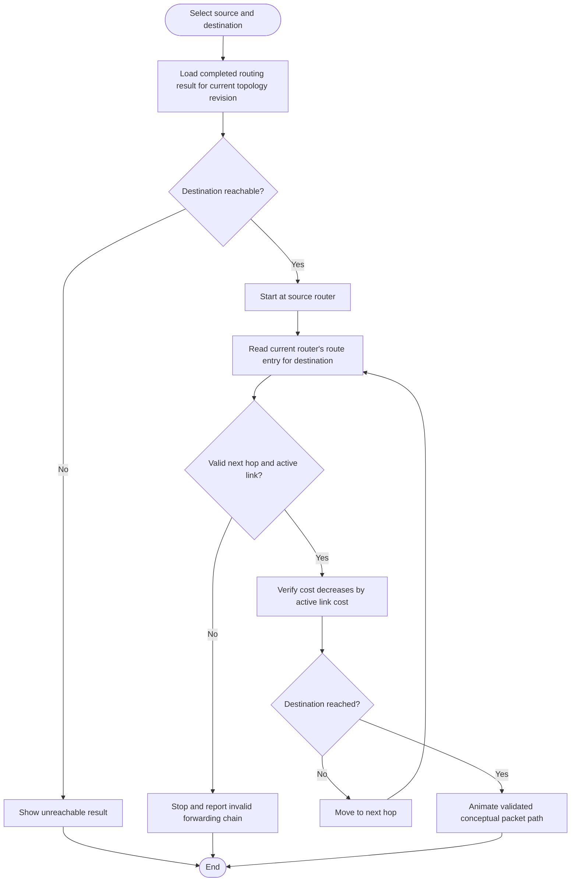
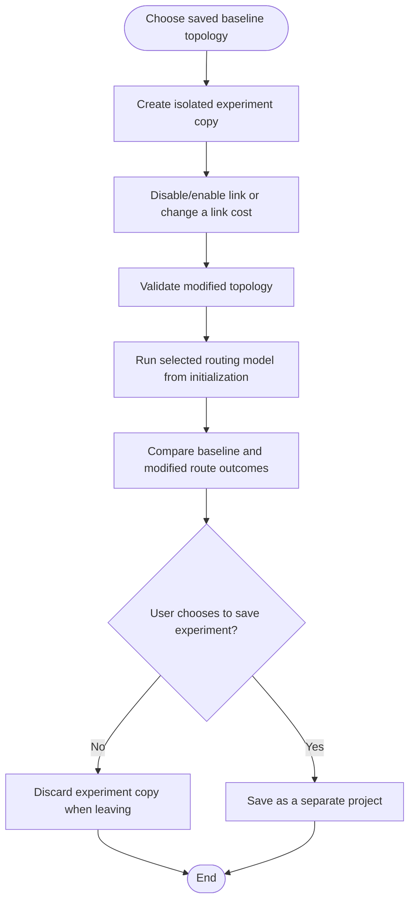

# RouteLab — Algorithm Flowcharts

These diagrams describe the educational models implemented by RouteLab. They are not intended to represent every timer, packet format or failure-recovery rule of production RIP or OSPF.

## 1. Distance Vector — synchronous Bellman-Ford model

### Key points

- All routers calculate from the same previous-round snapshot.
- A router evaluates only active neighbours.
- Candidate cost equals local link cost plus the neighbour's previous known cost to the destination.
- Equal-cost routes use the specified deterministic next-hop tie-break.
- Tables are committed simultaneously.
- The stable check round is included in the documented round metric.

### Core recurrence

[
D_x(y)=min_{vin N(x)} {c(x,v)+D_v(y)}
]

## 2. Link State — LSA flooding and Dijkstra

### Key points

- Each router originates one advertisement for the run.
- Flooding is deterministic and uses first-reception forwarding.
- Duplicate receptions are suppressed.
- Each router runs Dijkstra using its local link-state database.
- Unreachable destinations remain explicit.
- Published forwarding paths follow the routers' actual next-hop table decisions.

## 3. Packet Explorer — forwarding path

## 4. Network failure experiment lifecycle

## 5. Algorithm comparison interpretation

The directly comparable results are reachability and minimum route cost for the same source/destination and topology revision. Distance Vector rounds/vector messages and Link State LSA/Dijkstra counters must remain separately labelled because they count different types of model work. They are not elapsed-time measurements.
